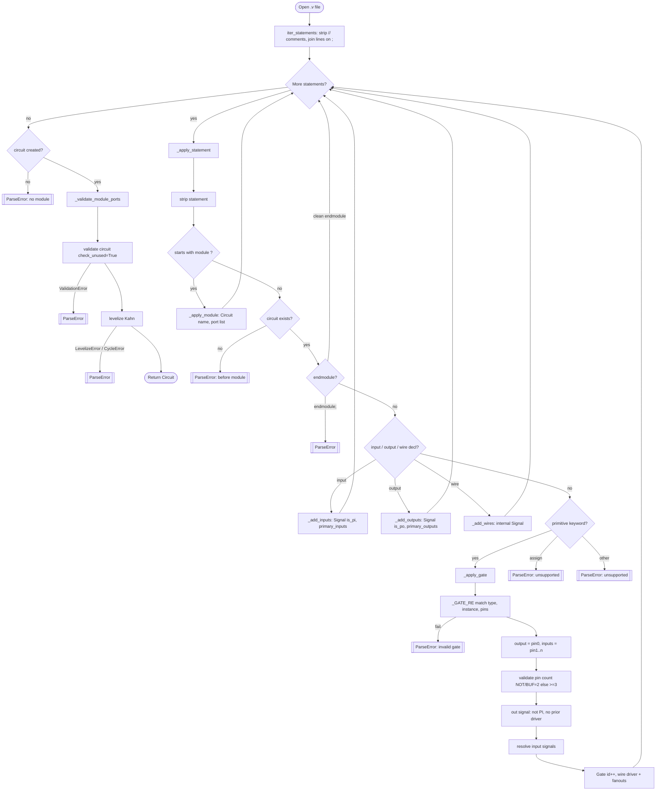
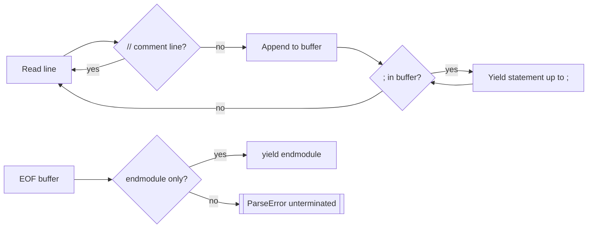
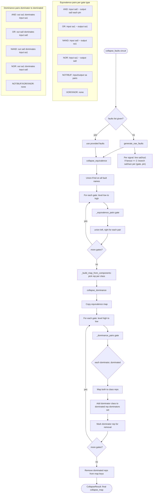
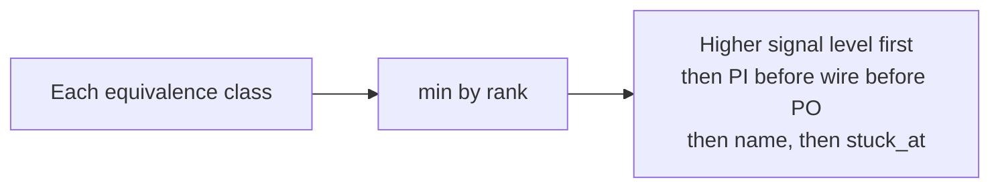
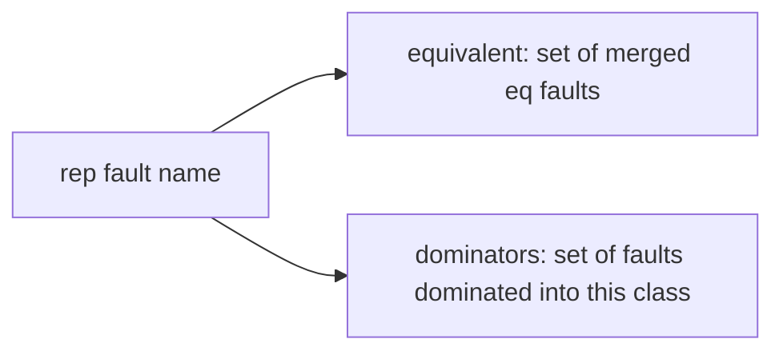

# Parser and fault collapser flowcharts

Sources: `src/parser/iscas_verilog.py`, `src/parser/verilog_utils.py`, `src/fault/collapsing.py`, `src/fault/fault.py`.

---

## 1. ISCAS Verilog parser (`parse_iscas_verilog`)

### Statement lexer (`iter_statements`)

---

## 2. Fault collapser (`collapse_faults`)

### Representative selection (`_pick_rep`)

### Collapse map shape

PODEM uses **representative keys** only (`collapse_map_keys`); a successful test on a rep marks covered via `all_collapsed_members(rep)`.
